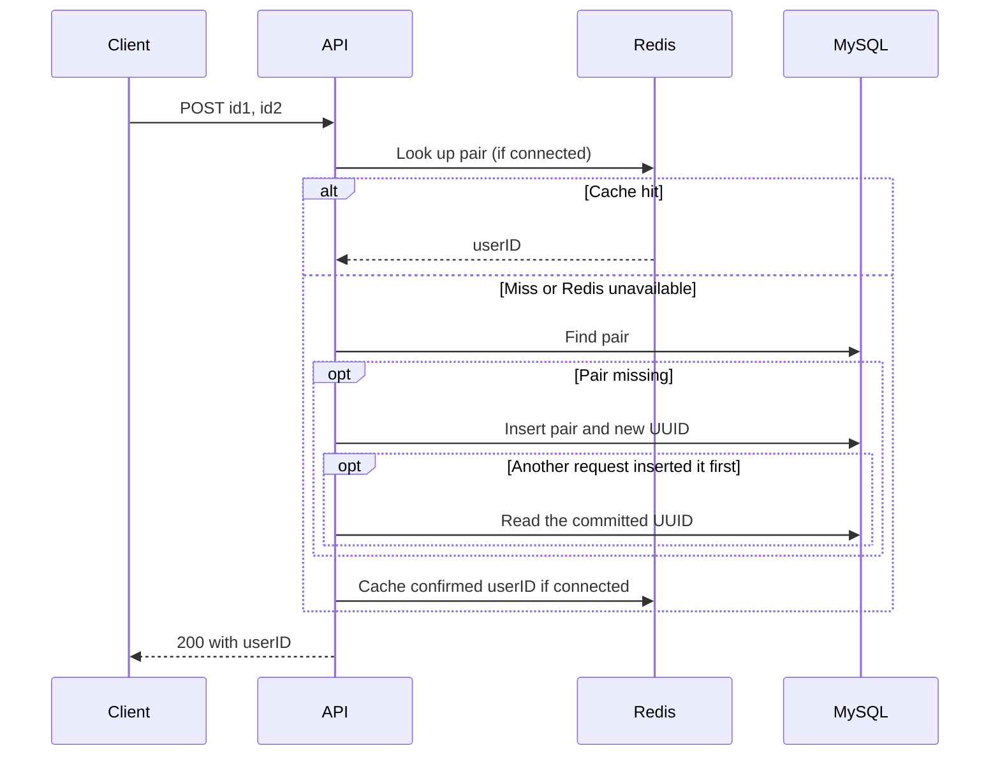

# Identity API

`POST /identities/resolve` assigns a UUID v4 to an ordered pair of identifiers. Send the same pair again to get the same UUID. MySQL 8 stores the mappings. Redis caches recent lookups for five minutes.

## Run with Docker

You need Docker with Compose v2. From the repository root:

1. Copy `.env.example` to `.env` (PowerShell: `Copy-Item .env.example .env`).
2. Set `MYSQL_PASSWORD` and `MYSQL_ROOT_PASSWORD` to different local passwords.
3. Run `docker compose up --build -d`. Check `docker compose ps` for the API and a healthy database.
4. Send the request below. Run `docker compose down` to stop the services. MySQL keeps the mappings in its named volume.

Compose imports `db/001-identities.sql` when it initializes the database volume. The credentials in the environment must match the accounts in that volume. The API, database and cache ports are bound to localhost.

## API

```http
POST /identities/resolve HTTP/1.1
Content-Type: application/json

{"id1":"ABC123","id2":"XYZ456"}
```

On PowerShell:

```powershell
Invoke-RestMethod -Method Post -Uri http://localhost:3000/identities/resolve -ContentType 'application/json' -Body '{"id1":"ABC123","id2":"XYZ456"}'
```

| HTTP status | Meaning |
| --- | --- |
| 200 | The pair was created or found. Example body: `{"userID":"550e8400-e29b-41d4-a716-446655440000"}`. |
| 400 | A field is missing or invalid, or the request contains an unknown field. The response includes validation messages. |
| 503 | A cache miss required a database lookup and the lookup failed. The client can retry the request. |

Each ID is a case-sensitive string of 1–128 Unicode characters after trimming surrounding whitespace. Position matters: switching two different IDs gives a different pair. There is no update or delete endpoint.

## Run without Docker

Use Node.js 22.9+ (or 24), npm and a running MySQL 8.4 server. Redis is optional.

1. Create a database and a local application user with access to it. Copy `.env.example` to `.env`; set `MYSQL_HOST`, `MYSQL_PORT`, `MYSQL_DATABASE`, `MYSQL_USER` and `MYSQL_PASSWORD` to match. The Node process uses only the application credentials.
2. Connect to the new database with the MySQL client. Run `SOURCE db/001-identities.sql;` from a client started in this repository. Use a database user with permission to create the table.
3. Run `npm ci`, `npm run build` and `npm start`. The API listens on `PORT` (3000 by default). Set `REDIS_URL` to enable caching.

You can also run only the dependencies with `docker compose up -d db redis` and start the Node process locally.

## Storage and concurrency

The primary key is `(id1, id2)`. Its binary collation keeps case and Unicode distinctions; `user_id` has a separate unique index. All requests use parameterized queries.

On a cache miss the API checks MySQL. If two callers both see a new pair, both may attempt an insert. The primary key allows one insert to commit. The caller that gets a duplicate-key error reads the committed row and returns its UUID. Each statement uses autocommit, so the second read can see the winning insert.



Only confirmed database mappings enter the cache. Redis timeouts fall back to MySQL. Each cache key hashes the JSON array of the two IDs, so punctuation inside either ID cannot change the pair boundaries. Use a separate cache per database. If you restore or replace the database, also restart the dedicated non-persistent Redis container to discard mappings from the old database.

## Tests

Install Node dependencies with `npm ci`. Run `npm test` for HTTP validation, cache-hit and database-error cases. These tests start Nest on a temporary localhost port and substitute the storage providers.

Run `npm run test:integration` against a **test database** initialized with the schema and configured in `.env`. The suite sends 24 concurrent HTTP requests for a new pair, checks every response and queries MySQL for the number of rows. It also checks case, pair order and the input-length boundary. It creates randomly named fixtures and removes its own rows. Leave `REDIS_URL` unset to exercise MySQL on every request.
